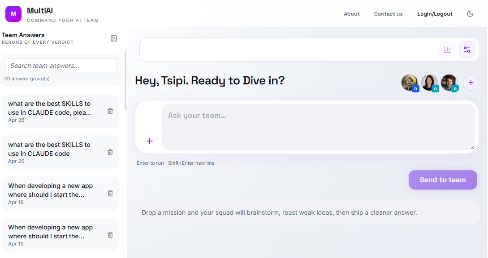
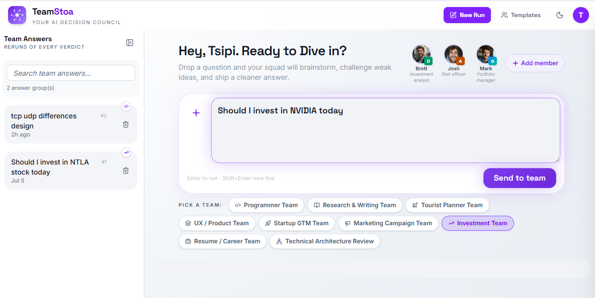
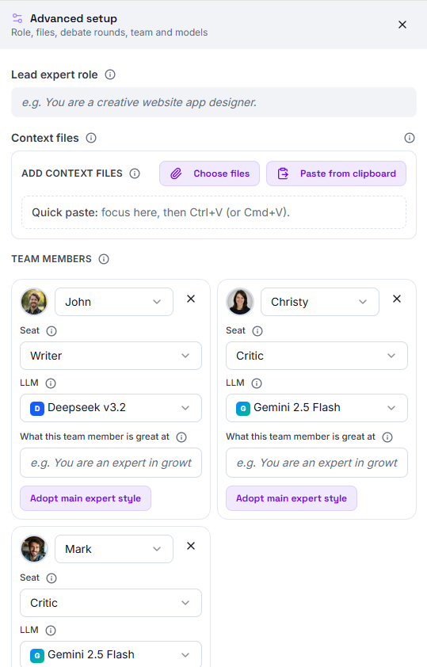
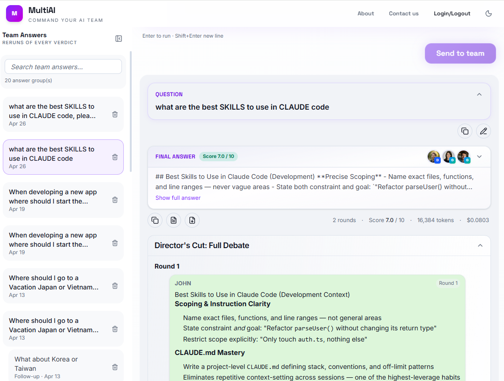
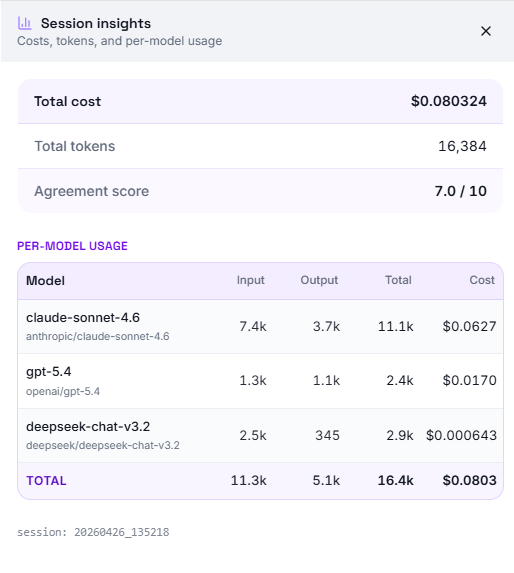

# TeamStoa

**Better answers through AI teamwork.**

TeamStoa is a full-stack multi-agent AI application where users configure a team of Writer and Critic agents, assign different LLM models and roles to each agent, ask a question, and receive a synthesized answer after structured debate, critique, scoring, and refinement.

Live app: https://www.teamstoa.com



## Why This Project Matters

Most AI apps return a single model response. TeamStoa explores a more deliberate workflow: multiple AI agents with different roles review the same question, challenge the answer, and converge on a final response with visible debate history and usage metadata.

This is a full-stack product built end to end: UX design, React implementation, authenticated FastAPI APIs, PostgreSQL persistence, multi-agent LLM orchestration, live progress streaming, public sharing, exports, and Railway deployment.

## Highlights

- **Multi-agent orchestration:** configurable Writer and Critic agents run through a structured debate loop.
- **Team templates:** users can quickly start from preconfigured teams for common use cases.
- **Per-agent LLM selection:** each team member can run on a different OpenRouter model, with its own display identity and role/expertise prompt.
- **Consensus workflow:** critic revisions are scored, summarized, and used to refine the final answer.
- **Live progress:** users can follow the debate as the team drafts, critiques, and converges.
- **Saved sessions:** authenticated users can revisit previous runs and follow-up threads.
- **Public sharing:** selected answers can be shared through public read-only links.
- **Exports:** final answers and debate transcripts can be exported for later use.
- **Usage visibility:** token, cost, model, and timing metadata are surfaced in the UI.
- **Production deployment:** frontend and backend are deployed on Railway with PostgreSQL persistence.

## Product Flow

```text
Question + optional context
        |
Configurable AI team
        |
Writer draft
        |
Critic reviews
        |
Consensus scoring
        |
Writer refinement
        |  repeat until score threshold or max rounds
Final synthesis
        |
Saved answer, debate transcript, and usage metadata
```

The app supports 1-6 Writer agents and 1-6 Critic agents. Multiple writers draft in parallel, critics review in parallel each round, and the primary writer handles refinement and final synthesis. The debate loop continues until the team reaches the user-defined consensus score or the run hits the user-defined maximum number of rounds.

## Core Features

### AI Debate Engine

- Writer/Critic debate loop with configurable max rounds and agreement threshold.
- Fast, Balanced, and Deep answer modes.
- Optional live web research for current questions.
- Relevance validation and final repair pass when needed.
- Rolling summaries to keep later rounds focused.

### Team Configuration

- Team templates for common use cases.
- Per-agent model selection through OpenRouter.
- Seat-specific `writer_roles` and `critic_roles`.
- Shared role fallback for older saved sessions and legacy clients.
- Context attachments, including extracted document text and limited image input.

### Account And Session UX

- Registration, login, password reset, and email verification.
- Saved run history scoped to the authenticated user.
- Follow-up sessions with thread context.
- Public share/unshare controls.
- Free-tier monthly quota support.
- Admin tools for user and account operations.

### Output And Insight

- Final answer view with agreement score.
- Full debate transcript.
- Session insights for cost, tokens, timing, and model usage.
- PDF and Markdown-style export surfaces.
- Mobile-responsive app shell and debate view.

## Technical Stack

| Area | Technology |
|---|---|
| Frontend | React, TypeScript, Vite |
| Styling/UI | Tailwind CSS, Radix primitives, Lucide icons |
| Backend | FastAPI, Python, Pydantic |
| Auth | fastapi-users, JWT |
| Database | PostgreSQL, SQLAlchemy, Alembic |
| LLM access | OpenRouter |
| Email | Resend or SMTP |
| Deployment | Railway |
| Testing | Pytest, Vitest |

## Architecture Highlights

- **API-first contract:** typed request/response schemas keep the frontend and backend aligned.
- **Database-backed sessions:** full debate sessions are persisted with user ownership and public sharing state.
- **Streaming progress updates:** long-running AI debates stream live status messages to the UI, so users can follow each stage instead of waiting on a blank loading state.
- **Model abstraction:** OpenRouter model IDs allow multiple providers to be used behind one integration.
- **Cost tracking:** usage is collected per model and exposed at the session level.
- **Auth-aware session scoping:** private sessions are owner-scoped, while shared sessions use read-only public slugs.
- **Backward compatibility:** legacy single-writer/single-critic payload fields are still accepted where needed.

## Project Structure

### Backend

The backend is a FastAPI Python service.

Main responsibilities:

- Receive consult requests.
- Manage authentication and user-scoped sessions.
- Handle clarification flow.
- Normalize context attachments.
- Run the debate/refinement loop.
- Call OpenRouter models.
- Score agreement between critic revisions.
- Validate answer relevance.
- Summarize rounds into rolling context.
- Synthesize the final answer.
- Track model usage, cost, tokens, and timing.
- Save sessions to PostgreSQL.

Key backend areas:

```text
api/app.py                  FastAPI routes
api/auth.py                 Authentication setup
api/schemas.py              Request/response contracts
api/sessions.py             Private session routes
api/shared.py               Public shared-session routes
consensus/engine.py         Main orchestration entry point
consensus/debate_runner.py  Multi-round writer/critic loop
consensus/prompts.py        Prompt templates
consensus/scorer.py         Agreement scoring
consensus/summarizer.py     Round summarization
consensus/validator.py      Relevance validation
consensus/usage_tracker.py  Token and cost tracking
consensus/models.py         DebateSession and DebateRound models
consensus/web_research.py   Optional live research support
storage/db_session_store.py Database-backed session persistence
config.py                   App configuration and env values
```

### Frontend

The frontend is a Vite React app written in TypeScript.

Main responsibilities:

- Team setup UI.
- Prompt input and command bar.
- Attachment controls.
- Session history and follow-up navigation.
- Live debate progress display.
- Final answer and full debate transcript views.
- Share and export actions.
- Session insights for cost, token, timing, and model usage.
- Auth, account, and admin screens.
- Dark mode and responsive mobile layout.

Key frontend areas:

```text
App.tsx                         Main app state and routing
components/compose/             Prompt input and command bar
components/drawers/AdvancedDrawer.tsx  Team setup, roles, sources, rounds, and models
components/drawers/InsightsDrawer.tsx  Cost, token, timing, and per-model usage
components/debate/ChatPanel.tsx         Final answer, full debate view, sharing, and export actions
components/layout/ConsensusRunsSidebar.tsx  Saved sessions sidebar
components/team/                Team member editing and template UI
data/experts.ts                 Team member structure and avatar options
data/templates.ts               Team templates and presets
data/models.ts                  Model options
lib/consultHelpers.ts           Team-to-API payload helpers
services/api.ts                 Backend API wrapper
services/pdf/                   Export generation
types.ts                        Shared frontend types
```

## Screenshots

### Team Workspace



### Configure Your Agent Team



### Debate And Consensus Process



### Usage And Agreement Metrics



## Run Locally

### Backend

```bash
uv pip install -r backend/requirements.txt
uv run uvicorn backend.api.app:app --reload --port 8000
```

### Frontend

```bash
cd frontend
npm install
npm run dev
```

Open `http://localhost:5173`.

## Tests

```bash
.venv/Scripts/python.exe -m pytest
cd frontend
npm test
```
